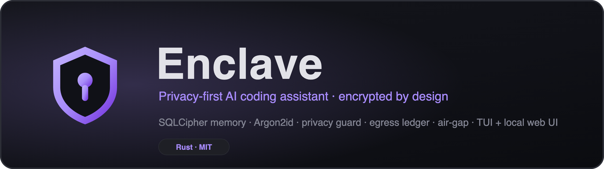
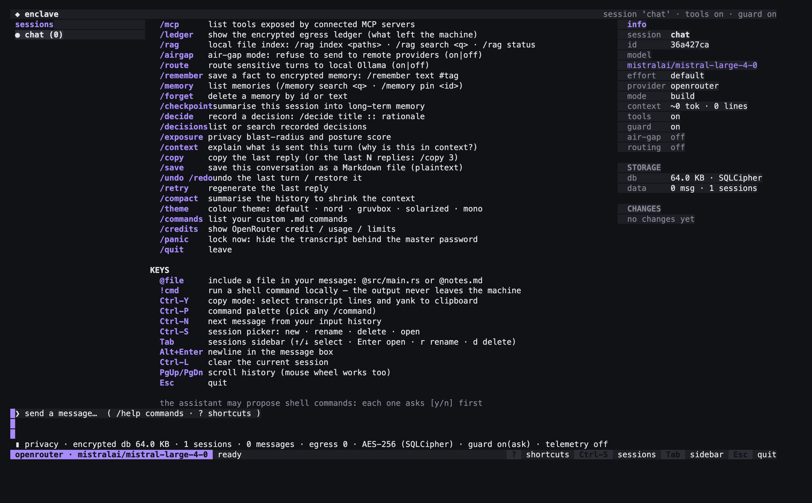
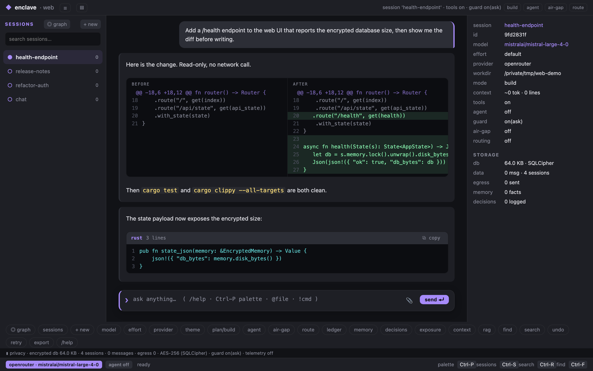

<p align="center">
  
</p>

<p align="center">
  <a href="LICENSE"></a>
  
  
  
  
</p>

**Enclave** is a privacy-first AI coding assistant that runs in your terminal — and in a local web UI. Encryption is the main feature, not an afterthought: your conversations live in an encrypted SQLCipher database, your keys never sit in plaintext, and you can *see* — and prove — exactly what leaves your machine.

> *A digital enclave: a fully isolated, encrypted space for your AI conversations.*

<p align="center">
  
  <br>
  <em>The terminal UI — sessions, transcript, live privacy bar and info panel.</em>
</p>

<p align="center">
  
  <br>
  <em>The local web UI (<code>enclave serve</code>, loopback + token): inline composer, code windows and before/after diffs.</em>
</p>

## Highlights

- 🔐 **Encrypted by design** — SQLCipher (AES-256) memory, Argon2id master key, `mlock` + zeroize, core dumps disabled.
- 🛡️ **Privacy guard** — detects emails, cards, secrets and names (local NER) *before* sending: send, redact or refuse. Flagged data is auto-scrubbed on later turns (taint tracking).
- 🧾 **Egress ledger** — every outbound request is logged (payload fingerprint, model, redaction map) in a hash-chained, encrypted ledger; `/exposure` shows your blast-radius and a privacy score.
- 🚧 **Air-gap & routing** — refuse remote providers entirely (`--airgap`), or route sensitive turns to local Ollama automatically.
- ⚙️ **Agentic tools** — read/write/edit/apply_patch/glob/grep/run_shell with ask-always approval, OS sandbox and Plan/Build modes.
- 🌿 **Conversation Git** — branch, merge, diff, graph, blame and provenance over your chat history.
- 🖥️ **Two interfaces** — a full TUI and a local web UI, same engine, same encryption.
- 🧠 **Project memory** — long-term memory, an ADR decision log, and a context inspector with a live token budget.
- 🔌 **Local models** — OpenRouter, OpenAI, Anthropic or **Ollama** (fully offline, nothing leaves the machine).

## Quickstart

```bash
# 1. Build / install
cargo install --path .        # or: cargo build --release && ./target/release/enclave

# 2. Store a provider key (written to a 0600 file; OS keychain optional)
enclave keys set openrouter
# ...or use an env var instead (no keychain prompt at all):
# export ENCLAVE_OPENROUTER_API_KEY=sk-or-...

# 3. Talk
enclave tui                   # full-screen TUI
enclave chat                  # line-based chat
enclave serve                 # local web UI (opens the browser automatically)

# 4. Fully offline (no API key, nothing leaves the machine)
ollama pull llama3.1
enclave tui --provider ollama
```

## Documentation

| Document | What it covers |
|----------|----------------|
| [docs/INSTALL.md](docs/INSTALL.md) | Requirements, install methods, first run, providers, troubleshooting |
| [docs/USAGE.md](docs/USAGE.md) | Full manual: CLI, TUI, web UI, privacy features, configuration |
| [docs/architecture.md](docs/architecture.md) | Modules, data flow, and where data lives on disk |
| [docs/privacy.md](docs/privacy.md) | Threat model and what is (not) encrypted |
| [docs/tools.md](docs/tools.md) | Shell proposals, agentic tools, permissions |
| [docs/providers.md](docs/providers.md) | Provider setup and how to add one |
| [SECURITY.md](SECURITY.md) | How to report a vulnerability |
| [CONTRIBUTING.md](CONTRIBUTING.md) | Development setup and PR workflow |
| [CHANGELOG.md](CHANGELOG.md) | Release history |

## Why

Existing AI CLIs store your history in plaintext and your API keys in plain files. Enclave exists to fix that:

| Aspect | Typical AI CLI | Enclave |
|--------|----------------|---------|
| Chat history | ❌ Plaintext on disk | ✅ AES-256 (SQLCipher) |
| API keys | ❌ Plaintext file (`auth.json`) | ✅ Local `keys.toml` (0600) or OS keychain |
| Master key | ❌ None | ✅ Argon2id (or PBKDF2) + mlock/no-swap |
| Telemetry | ⚠️ Unclear | ✅ Zero by default |
| Local models | ⚠️ Limited | ✅ Ollama (100% offline) |

## Security model

- **Zero plaintext at rest** — chat history lives in a SQLCipher database (AES-256, HMAC-SHA512, 256k KDF iterations). Nothing readable without the master key.
- **API keys never in plaintext** — by default keys are stored in a local `keys.toml` with mode `0600`, or read from an environment variable (`ENCLAVE_<PROVIDER>_API_KEY`). The OS keychain (macOS Keychain, Windows Credential Manager, Linux Secret Service) is supported via `enclave keys set --keychain` and used as a fallback.
- **Password-derived master key** — Argon2id (memory-hard) by default, PBKDF2-HMAC-SHA256 (600k) for legacy vaults, with a random 32-byte salt. The key is zeroized on drop and `mlock`-ed so it never hits swap; core dumps are disabled.
- **Zero telemetry** — no data leaves the machine unless you chat with a remote provider. For sensitive content, use Ollama: fully offline.

## Install

```bash
cargo install --path .
```

## Usage

```bash
# Store an API key (goes to the OS keychain)
enclave keys set openrouter

# ...or provide it via an environment variable (no keychain prompt at all)
export ENCLAVE_OPENROUTER_API_KEY=sk-or-...
# also recognized: OPENROUTER_API_KEY, OPENAI_API_KEY, ANTHROPIC_API_KEY

# Start an encrypted chat
enclave chat --provider openrouter --model mistralai/mistral-large-4-0

# Fully offline chat with a local model
enclave chat --provider ollama --model llama3.2

# Full-screen TUI
enclave tui
enclave tui --no-tools   # TUI without shell-proposal prompts
enclave tui --agent      # agentic tool loop (read/write/edit files, shell)
enclave tui --effort high  # reasoning effort hint (low|medium|high)
enclave tui --plan       # start in Plan mode (read-only, proposes steps)
enclave chat --agent --auto  # auto-approve tools not explicitly denied

# Attach a file to the first message (image for multimodal models, or text)
enclave chat --attach ./diagram.png --attach ./notes.md

# Manage sessions
enclave sessions list
enclave sessions rename <id> "new name"
enclave sessions delete <id>

# Export/import sessions (encrypted with a dedicated password)
enclave sessions export <id> backup.enclave
enclave sessions import backup.enclave

# Show resolved configuration (no secrets)
enclave config

# Nuke everything (irreversible)
enclave wipe --force
```

## In-chat commands

| Command | Action |
|---------|--------|
| `exit` / `quit` | Leave the chat |
| `clear` | Wipe the current conversation |
| `history` | Show recent messages |

## Tools (shell proposals)

When the assistant includes a fenced ` ```bash ` block, Enclave shows the
command and asks before doing anything:

```text
— the assistant proposed 1 shell command(s); nothing runs without your approval —
$ sw_vers
run? [y]es / [n]o / [a]ll / [q]uit >
```

Built-in guardrails:

- **ask-always**: the default answer is *no*; there is no auto-run mode
- **hard timeout** (30s default) — runaway commands are killed
- **output cap** (8KB default) — truncates display *and* what enters the history
- **`--no-tools`** disables proposals entirely (also `tools.enabled = false` in `config.toml`)
- command output is stored in the encrypted history and will be sent to the
  provider on the next turn — use `--provider ollama` to keep it local

## Privacy Guard (sensitive-data interception)

Before any message reaches a **cloud** provider, Enclave scans it for
sensitive data. Detected categories: emails, phone numbers, IBANs, Italian
tax IDs, card numbers (Luhn-validated), API secrets (`sk-…`, `ghp_…`, AWS,
JWT…) and IP addresses.

```text
⚠ privacy guard — 2 sensitive item(s) detected:
  · email: mario.rossi@gmail.com
  · phone: +39 333 1234567
send [s]as-is / [p]laceholders / [r]efuse >
```

- **as-is**: you explicitly approve this session's content for the network
- **placeholders**: every occurrence is replaced with a stable token
  (`[EMAIL_1]`, `[IBAN_1]`, …) in **every outgoing request**, while the
  original text stays only in the encrypted local history
- **refuse**: the message is not sent; in the TUI it returns to the input
  box for editing

Configuration (`config.toml`):

```toml
[guard]
enabled = true
mode = "ask"   # ask | redact (auto-placeholder) | block (auto-refuse)
```

`--no-guard` disables the scan (not recommended). Detection runs on every
turn — including the whole history that is re-sent — with stable placeholder
numbering, so the model never sees inconsistent tokens.

## Long-term memory (Supermemory)

Enclave keeps a **local, encrypted memory** of facts, preferences and notes
that persists across sessions and is injected into the system prompt. It lives
in the same SQLCipher `vault.db` as your conversations — nothing is sent to an
external memory service.

In the TUI:

| Command | Action |
|---------|--------|
| `/remember <text> #tag` | Save a fact (`--local` keeps it off the network) |
| `/memory` | List memories (`/memory search <q>` to search, `/memory pin <id>`) |
| `/forget <id\|text>` | Delete a memory by id or by matching text |
| `/checkpoint` | Summarise the current session into long-term memory |

From the CLI:

```bash
enclave memory add "prefers Rust" --tags langs
enclave memory list
enclave memory search rust
enclave memory pin <id>          # also: --off to unpin
enclave memory forget <id|text>
enclave memory clear --force
```

Configuration (`config.toml`):

```toml
[memory]
enabled = true          # inject memories into the system prompt
inject_limit = 50       # max memories injected
autosave_secs = 0       # >0 = periodically checkpoint the session (opt-in)

# The session Enclave reopens on launch (set automatically as you switch).
working_session = "9f3c1a2b-…"
```

- **Injection**: the most relevant memories (pinned first, then most recent)
  are added to the system prompt, up to `inject_limit`. Injected text is
  context like any other, so the **privacy guard applies** before it goes to a
  cloud provider.
- **`--local` / `local_only`**: such memories are stored but **never injected**
  into requests that leave the machine.
- **Agent tool**: in agentic mode the model can save memories itself via the
  `remember` tool (permission-gated).
- **Working session**: Enclave remembers which session you were in and reopens
  it on the next launch.

## Project decisions (ADR log)

Enclave can record the **rationale** behind decisions ("why did we choose X?")
as an encrypted, ADR-style log in the same `vault.db`. Recorded decisions are
injected into the system prompt (like memories) so the model respects them, and
they can be searched later.

In the TUI:

| Command | Action |
|---------|--------|
| `/decide <title> [:: rationale]` | Record a decision |
| `/decisions [query]` | List or search decisions |

From the CLI:

```bash
enclave decisions add "Mistral over Llama" --body "better tool-calling" --tags ai
enclave decisions list
enclave decisions search tool
enclave decisions status <id> superseded
enclave decisions forget <id|text>
```

In agentic mode the model can record decisions itself via the `decide` tool
(permission-gated). Statuses: `accepted` · `proposed` · `rejected` · `superseded`.

## Privacy exposure (blast-radius & score)

`enclave exposure` aggregates the encrypted egress ledger into a **privacy
blast-radius** — how much went out, to which providers, how much was redacted —
plus a **privacy posture score** (0–100, grade A–F) computed from your settings
(guard, taint, air-gap, routing, sandbox, proxy/Tor) and your outgoing traffic.

```bash
enclave exposure            # whole vault
enclave exposure --session  # most recent session only
```

The same view is available in the TUI (`/exposure`, alias `/blast-radius`) and
the web UI (toolbar **exposure** button / `/exposure`). It shows **counts and
kinds only — never payloads or secrets**. The score's factors explain each
contribution (e.g. `+18 air-gap`, `-4 remote sends`).

## Context inspector (what is sent this turn)

`enclave context` answers **"why is this in context?"**: it breaks the outgoing
request into its labelled parts — system prompt, local `AGENTS.md` rules, Plan
note, injected **memory**, **decisions**, anti-injection notice — each with a
preview and its size, plus the history size, the active **redactions** and the
**taint** status.

```bash
enclave context                 # working session
enclave context --session <id>  # a specific session
```

Also available in the TUI (`/context`) and the web UI (toolbar **context**
button / `/context`). Nothing is sent by inspecting — it reads the same
composition the engine would send.

**Budget.** Set a soft token budget and the inspector shows a live usage bar,
turning yellow past `warn_pct`% and red past 100% (rough estimate: one token per
four characters):

```toml
[context]
budget_tokens = 128000
warn_pct = 80
```

## Workspace checkpoints (snapshot & rewind)

Before the assistant changes a file in **agentic mode**, Enclave takes a
**local snapshot** of your working directory into a private *shadow* git repo
(kept in the app data dir — never your project's own `.git`, never the network,
with a neutral `Enclave` commit identity so your git identity never leaks).
If an edit goes wrong you can rewind.

```bash
enclave checkpoint list            # recent snapshots (id · when · label)
enclave checkpoint create "wip"    # snapshot now (nothing to do if unchanged)
enclave checkpoint diff <id>       # what that snapshot changed
enclave checkpoint restore <id>    # rewind the workspace (a safety snapshot is taken first)
```

In the TUI: `/snapshots` (list), `/snapshot [label]`, `/rewind <id|n>`.
In the web UI: the **snapshots** toolbar button (list + ↺ restore), or
`/snapshots`, `/snapshot`, `/rewind`. History stays **linear and reversible** —
a rewind is itself a new snapshot, so you can always go back.

Disable with `[checkpoints] enabled = false` in `config.toml`.

## Auto verification loop

After the assistant edits files in agentic mode, Enclave can run your project's
own checks **locally** and hand failures back to the model so it fixes them by
itself — no need to copy/paste test output. Enclave auto-detects the command
from `Cargo.toml` (`cargo test`), `package.json` (`npm test`), `pyproject.toml`
(`pytest`), `go.mod` (`go test ./...`) or a `Makefile` test target.

```bash
enclave verify                     # run the detected checks now
enclave verify --command "make lint"
```

In the TUI: `/verify`. In the web UI: the **verify** toolbar button or `/verify`.
Configure with:

```toml
[verify]
auto = true                 # verify after edits and feed failures back (default)
command = "cargo test"      # optional: override auto-detection
max_attempts = 2            # how many times a failure is fed back
timeout_secs = 300
```

## Command risk classifier

Shell commands proposed by the model are classified **offline** before they
run. Clearly destructive ones — `rm -rf /` or `~/`, `dd of=/dev/…`, `mkfs`,
`curl … | sh`, `shutdown`, a fork bomb — are **refused by default** and, as a
badge, marked in every approval panel (`⚠ dangerous — piping a download
directly into a shell`). Risky-but-recoverable ones (`git push --force`,
`git reset --hard`, `sudo`, `history -c`) are flagged `⚠ risky`. Ordinary
commands (`cargo test`, `git status`, `rm -rf target/`) are not flagged.

```toml
[permissions]
block_destructive = true    # refuse dangerous commands (default);
                            # set false to always ask instead
```

## Agent Skills (local instruction packs)

A *skill* is a `SKILL.md` file that teaches the model how to do something
specific for your project (a deploy procedure, a release checklist, an API
convention). Enclave discovers them locally and offers only the **name and
description** to the model; the full body is loaded on demand — progressive
disclosure, so the context stays small until a skill is actually needed.

```
.enclave/skills/deploy/SKILL.md     # project skills (highest priority)
<config>/skills/deploy/SKILL.md     # global skills
```

```markdown
---
name: deploy
description: How to cut a release
---
# Deploy
1. `cargo test`
2. `scripts/release.sh`
```

* TUI: `/skills` lists them, `/skill <name>` shows one; the model can load one
  itself through the `skill` tool (read-only).
* Web UI: **skills** toolbar button.
* Fully local — nothing is fetched remotely.

## Repository map (files → symbols)

A compact, offline map of the repository (which file defines which function /
struct / class), extracted with language-specific patterns for Rust, Python,
JS/TS, Go and a generic fallback. A bounded version is injected into the
context (`[context] repomap = true`, default) and the model can pull a filtered
one with the `repo_map` tool. TUI: `/repomap`.

```toml
[context]
repomap = true              # inject a compact repo map (default)
```

## Tool hooks

Run a local shell command *around* every tool call: `pre_tool` can **block** a
call by exiting non-zero, `post_tool` runs after it. Both receive
`ENCLAVE_TOOL`, `ENCLAVE_TOOL_ARGS`, `ENCLAVE_HOOK_EVENT` and
`ENCLAVE_WORKSPACE` in the environment. There is no recursion (hooks run
through the shell directly, in the same sandbox).

```toml
[hooks]
pre_tool  = "echo $ENCLAVE_TOOL >> ~/.enclave-hooks.log"
post_tool = "notify-send 'enclave' "$ENCLAVE_TOOL done""   # optional
timeout_secs = 30
```

## Git worktrees

Work on several branches at once, each with its own working directory, without
stashing. Enclave manages them locally under the app data dir.

```bash
enclave worktree list
enclave worktree add feature-x          # -> <data>/worktrees/feature-x on a new branch
enclave worktree remove feature-x --force
```

TUI: `/worktree` lists, `/worktree new <name>` creates, `/worktree use <name>`
switches the agent workspace to that worktree. Web UI: **worktree** button.

## Conversation branches (Conversation Git)

Enclave can treat a conversation like **git treats code**: instead of a single
linear timeline you can fork it, explore alternatives in parallel, and compare
branches — all stored encrypted in the vault.

| Command | What it does |
|---------|--------------|
| `/branch [name]` | Fork the current conversation into a new branch at its current head. The parent is left untouched. Default name `<parent>~N`. |
| `/log` | Show the ASCII branch tree (roots, forks, message counts, `●` = current). |
| `/checkout <name\|id>` | Open a branch directly by name or id. |
| `/diff <a> <b>` | Show a line-diff between two sessions (branches). |
| `/merge <branch>` | Append the turns a branch has beyond the common prefix into the current session. |
| `/graph` | Navigable branch graph overlay (↑/↓ select, Enter opens a branch). |
| `/blame <text>` | Locate which turns contain some text and whether it was inherited from the parent branch or introduced here. |
| `/provenance` | What left the machine for this session (from the encrypted egress ledger). |

CLI equivalents:

```bash
enclave sessions log                         # print the branch tree
enclave sessions branch --from <id> --name alt --keep 4
enclave sessions diff <branch-a> <branch-b>  # name or id prefix
enclave sessions merge <source> --into <target>
enclave sessions provenance [id]             # egress ledger for a session
```

Each forked session records its **parent** and **fork point** (`branches` lineage
in `vault.db`), so the tree is reconstructed locally and never leaves the machine.
The fork copies the first `keep` messages (all by default), so a branch can start
from any earlier point of the conversation.

## Security hardening

Wave A of the [security roadmap](docs/security-roadmap.md) is implemented.

**Master key.** New vaults derive the master key with **Argon2id** (memory-hard).
Legacy PBKDF2 vaults keep working (the algorithm is recorded in the salt header).
Set the default for *new* vaults with `kdf = "argon2id" | "pbkdf2"`. The key is
held in a `mlock`-ed heap buffer (never swapped) and zeroized on drop; core dumps
are disabled at startup.

**Egress ledger.** Every request that leaves the machine is recorded — in the
encrypted `vault.db` — as a SHA-256 fingerprint plus the model, timestamp and the
guard's redaction map. **No payload or secret is ever stored in clear.** The chain
is tamper-evident:

```bash
enclave ledger            # list recent egresses (fingerprints only)
enclave ledger --verify   # verify the hash chain (exit 2 if tampered)
```

In the TUI the privacy bar shows the egress count and `/ledger` opens the list.

**Locking and clipboard.** In the TUI:

| Behaviour | Config | Default |
|-----------|--------|---------|
| Auto-lock after inactivity (hides the transcript behind the master password) | `[security] auto_lock_secs` | `0` (off) |
| Clipboard auto-clear after copying from Enclave | `[security] clipboard_clear_secs` | `30` s |
| Blur the view when the window loses focus | always on | — |
| Instant lock + hide | `/panic` | — |

The clipboard is cleared only if it still holds the text Enclave copied.

**Duress password.** Set `ENCLAVE_DURESS_PASSWORD` in your environment; typing
that password at the master-password prompt opens a **separate decoy vault**
(`<config>/decoy/`) instead of the real one. It is never written to `config.toml`.

```toml
[security]
auto_lock_secs = 300        # lock the TUI after 5 minutes idle (0 = off)
clipboard_clear_secs = 30   # clear Enclave-copied clipboard text after 30s
```

**Command sandbox.** On macOS, the shell commands you approve (markdown
proposals, the agentic `run_shell` tool, and `!command`) run inside a
`sandbox-exec` jail: file reads are allowed, but writes are restricted to the
workspace and temporary directories. Set `[tools] sandbox = "strict"` to also
block network access, `"fs"` for the file jail only, `"off"` to disable it, or
`"auto"` (default) to use the strongest sandbox the platform supports.

```toml
[tools]
sandbox = "auto"   # auto | off | fs | strict
```

**Taint tracking.** When the privacy guard detects sensitive data in a message
you send, that message is flagged *tainted* and stored that way. On every later
turn the engine automatically re-redacts tainted messages (stable placeholders
like `[EMAIL_1]`) before they leave for a **remote** provider — without asking
again and regardless of the per-message guard choice — so once a secret has
entered the conversation it can never travel verbatim in a subsequent request.
Set `[guard] taint = false` to disable this. Local (Ollama) sessions are
unaffected: nothing leaves the machine.

**Egress policy (policy-as-code).** A local, declarative policy can force how
each class of sensitive data may leave the machine. Define rules per data kind
in `[policy]`; before any request to a **remote** provider the engine scans the
outbound messages and applies the *strictest* matching action — `allow`,
`redact` (placeholders) or `block` (the turn is refused). Local (Ollama)
providers are never restricted. Example:

```toml
[policy]
enabled = true
default = "allow"            # action for kinds without a rule

[policy.rules]
email = "redact"
phone = "redact"
iban = "block"
card = "block"
secret = "block"
tax_id = "block"
ip = "allow"
```

Recognised keys: `email`, `phone`, `iban`, `tax_id`, `card`, `secret`, `ip`.

**Air-gap.** `enclave tui --airgap` (or `air_gap = true` in `config.toml`, or the
`/airgap` toggle in the TUI) puts the session in air-gap: the engine **refuses to
send anything to a remote provider**, so no data can leave the machine. Use a local
provider (Ollama) to keep working. Utility calls (`/compact`, `/checkpoint`, `/init`)
are blocked too.

**Prompt-injection hardening.** Tool outputs, file contents and any other external
text are treated as **untrusted data**, never instructions. A secret per-run *canary
token* is injected into the system prompt: if a reply or tool output ever echoes it,
Enclave records a security warning and marks the reply untrusted. In addition, a tool
call that follows untrusted output always needs a **fresh approval** (even under
`--auto`). Disable with `[guard] injection = false`.

**Sensitivity routing.** With `[routing] sensitive = "local"` (or the `/route` toggle,
or `--route` semantics in the TUI) a turn whose content the guard flags as sensitive is
automatically sent to the **local Ollama** provider instead of the remote one, so it
never leaves the machine. Non-sensitive turns keep using the configured provider.

**Network hardening (proxy / Tor / TLS pinning).** The `[network]` section routes
every provider request through a proxy and/or pins the provider's TLS certificate:

```toml
[network]
tor = true                       # route through a local Tor SOCKS proxy (127.0.0.1:9050)
# proxy = "socks5h://127.0.0.1:9050"   # or an explicit http/https/socks5h proxy
# tls_pin = "ab12…"               # SHA-256 (hex) of the provider leaf certificate
```

`tor = true` (or an explicit `socks5h://` proxy) hides the origin of the connection;
`socks5h` resolves DNS through the proxy so no lookup leaks. When `tls_pin` is set the
TLS handshake fails unless the server presents exactly that certificate (defends
against MITM / a compromised CA).

**Local semantic guard (NER).** Beyond the regex PII patterns, the guard runs a
small **offline** recognizer for what regex misses — person names, organisations and
postal addresses — plus a user-defined list of sensitive terms. Nothing is sent
anywhere: detection is pure local heuristics you can review and placeholders like
`[NAME_1]`, `[ORG_1]`, `[ADDRESS_1]`, `[CUSTOM_1]` are applied only when you choose to.

```toml
[guard]
ner = true                        # local name/organisation/address detection (offline)
entities = ["Project Phoenix", "Acme S.p.A."]   # your own sensitive terms
```

Each detected kind can also be gated by the egress policy (`name`, `org`, `address`,
`custom` keys in `[policy.rules]`). Set `ner = false` to keep only the regex patterns.

**Local DLP judge.** For a second opinion, point `[policy] judge` at a local
**Ollama** model: before any payload leaves to a *remote* provider, Enclave asks
that local model whether the text still looks sensitive and applies `judge_action`
(`allow` / `redact` / `block`). It runs entirely offline and fails open (a judge
error never blocks you).

```toml
[policy]
enabled = true
judge = "llama3.2:1b"      # Ollama model used as a local DLP judge (remote providers only)
judge_action = "redact"    # allow | redact | block
```

**Proof-of-redaction.** The encrypted egress ledger records, for every redacted
request, the SHA-256 of the payload as sent **and** a commitment (SHA-256) to the
original text, next to the redaction map. You can later prove what was on the wire:

```bash
enclave ledger --proof <id>     # show the sent hash, the original commitment and the redaction map
```

## Agentic mode (function calling)

Beyond markdown *proposals*, Enclave supports real function calling: the
model receives a typed tool schema and returns structured tool calls that
Enclave executes for it, feeding results back until the task is done.

```bash
enclave chat --agent                      # built-in tools + ask-always approvals
```

Built-in tools (workspace-restricted, human-approved):

| Tool | What it does |
|------|--------------|
| `read_file` | Read a file inside the workspace (optional `offset`/`limit` line range, output capped) |
| `write_file` | Write a file inside the workspace (path traversal rejected) |
| `edit_file` | Replace an exact `old_string` with `new_string` (fails if missing or ambiguous) |
| `apply_patch` | Apply a unified diff (multi-hunk) to a file in one call |
| `list_dir` | List a directory inside the workspace |
| `glob` | Find files by glob pattern (`**/*.rs`, `src/*.toml`, …) |
| `grep` | Search file contents by regular expression (optional `glob` filter) |
| `run_shell` | Run a shell command (same timeout + output cap as proposals) |
| `todo` | Record/update a task list (shown in the info panel) |
| `question` | Ask you a multiple-choice question mid-task (interactive in the CLI) |

File writes/edits return an inline diff (green `+` / red `−`) which is also
recorded in the info panel **CHANGES** list.

Guardrails: every call needs explicit approval (`[y]es/[n]o/[a]ll/[q]uit`,
ask-always), paths are canonicalized and confined to the current directory,
`..` and absolute paths outside the workspace are rejected, max 8 tool
iterations per turn. The privacy guard redacts tool arguments/results the
same way as chat text.

### Rules (`AGENTS.md`)

Enclave automatically loads local rule files into the system prompt — all
resolved **locally**, never fetched from the network:

| Location | Scope |
|----------|-------|
| `<config_dir>/AGENTS.md` | Global instructions (e.g. `~/.config/enclave/AGENTS.md`) |
| nearest `AGENTS.md` walking up from the cwd to the git root | Project instructions |
| `instructions = ["docs/STYLE.md", ...]` in `config.toml` | Extra local files (relative to the cwd; `http(s)://` entries are ignored) |

The nearest project file wins per category; global and project rules are
concatenated, then any `instructions` entries. Remote URLs are never fetched.

### Permissions

Tool calls are gated by a `[permissions]` table in `config.toml`. Each rule
is `allow`, `ask` or `deny`:

```toml
[permissions]
read = "allow"        # read_file
write = "ask"         # write_file / edit_file
bash = "ask"          # run_shell
default = "ask"       # fallback for tools without a specific rule
external_directory = "ask"  # any path outside the workspace

[permissions.bash_rules]
"git status *" = "allow"
"rm *" = "deny"
```

Defaults are read-only friendly: `read_file`/`list_dir`/`glob`/`grep` are
`allow`, mutations (`write_file`/`edit_file`/`run_shell`/`delegate`) are
`ask`, and `external_directory` is `ask`. `bash_rules` entries are matched
against the parsed command; the **longest** matching pattern wins (ties go
to the most restrictive). `--auto` (CLI) auto-approves anything not
explicitly denied; a repeated identical tool call (`doom_loop`) can be gated
to break loops.

### Plan / Build mode

Like opencode, Enclave has two modes:

- **build** (default): all tools available.
- **plan**: read-only — `write_file`, `edit_file`, `run_shell` and `delegate`
  are refused, and a planning note is added to the system prompt so the model
  analyses and proposes steps instead of changing anything.

Switch with `Shift+Tab` in the TUI, the `/plan` and `/build` slash commands,
or the `--plan` flag on `enclave chat` / `enclave tui`. The current mode is
shown in the info panel.

### Multi-agent (delegate)

Define sub-agents in `config.toml` — each with its own provider/model/persona
(sub-agent sessions are ephemeral: RAM-only, never written to disk):

```toml
[agent.personas.researcher]
provider = "openrouter"
model = "mistralai/mistral-large-4-0"
system_prompt = "You research topics and report facts back concisely."

[agent.personas.writer]
provider = "ollama"
model = "llama3.2:1b"
system_prompt = "You turn research notes into short summaries."
```

The main agent then gets a `delegate(agent, task)` tool: it can hand
subtasks to sub-agents and collect their results. Depth limit: sub-agents
cannot delegate further (no fan-out explosions). Example:

```bash
enclave chat --agent
you> use the researcher agent to summarize the state of encrypted messaging, then have the writer produce a tweet-length summary
```

## TUI keybindings

| Key | Action |
|-----|--------|
| `Enter` | Send message |
| `Alt+Enter` | New line in the input box (multiline) |
| `Esc` / `Ctrl-C` | Quit |
| `Ctrl-Y` | Copy mode: select transcript lines (↑/↓, PgUp/PgDn, Home/End) and press `y` to copy to the clipboard — `a` selects all, `e` copies the last reply |
| `Ctrl-P` | Command palette — pick any `/command` from a searchable list |
| `Ctrl-N` / `Alt+P` | Recall next / previous message from the input history |
| `Ctrl-F` | Find text in the current conversation (type to search, Enter copies the line) |
| `Ctrl-R` | Search text across **all** saved sessions (Enter opens the session) |
| `Ctrl-O` | Edit the message box in `$EDITOR` (`$VISUAL` → `vi`) |
| `Ctrl-L` | Clear the session (wipes encrypted history, starts fresh) |
| `Ctrl-W` / `Ctrl-U` | Delete word / clear input |
| `PgUp` / `PgDn` (or ↑/↓) | Scroll transcript |
| `?` (empty input) | Toggle the shortcuts overlay |
| Mouse wheel | Scroll transcript |
| `Tab` | Toggle focus between chat and the sessions sidebar |
| `Shift+Tab` | Toggle Plan / Build mode |
| `Ctrl-S` | Open the session picker overlay (works at any terminal size) |
| `@file` in the input | Fuzzy file completion popup (↑/↓ + `Enter`/`Tab` to insert the path) |
| `↑`/`↓` + `Enter` (sidebar or picker) | Switch to another encrypted session |
| `n` (sidebar or picker) | Create a new session — asks for a name first |
| `r` (sidebar or picker) | Rename the selected session (inline prompt) |
| `d` (sidebar or picker) | Delete the selected session (the active one is protected) |
| Mouse click (sidebar row) | Open that session |
| `y` / `n` / `a` / `q` | Approve / deny / approve-all / skip shell proposals |
| `s` / `p` / `r` / `Esc` (guard overlay) | Send as-is / placeholders / refuse sensitive data |

Slash commands (typed in the message box, executed locally, never sent to the provider):

| Command | Action |
|---------|--------|
| `/help` | Command list |
| `/new` | Create a new session (asks for a name) |
| `/switch` | Open the session picker overlay (also `Ctrl-S`) — aliases `/sessions`, `/resume`, `/continue` |
| `/clear` | Wipe the current session history |
| `/model` | Open the model picker (type to filter, ↑/↓/PgUp/PgDn select, Enter choose, Esc close) — the choice is saved for next launches |
| `/model <id>` | Switch model directly (saved for next launches) |
| `/models` | Alias of `/model` (opens the picker) |
| `/effort` | Set reasoning effort: `off` · `low` · `medium` · `high` (saved) |
| `/attach <path>` | Attach an image or text file to your next message |
| `/detach` | Clear pending attachments |
| `/plan` / `/build` | Switch to Plan (read-only) / Build mode |
| `/copy [n]` | Copy the last reply (or the last `n` replies) to the clipboard |
| `/save [path]` | Save this conversation as a Markdown file (plaintext, not encrypted) |
| `/undo` | Remove the last user turn and put it back in the input box |
| `/redo` | Restore the text removed by the last `/undo` |
| `/retry` | Undo the last turn and resend the same message |
| `/compact` | Summarise the conversation and replace the history with the summary (alias `/summarize`) |
| `/commands` | List your custom commands (see below) |
| `/find <text>` | Search the current conversation (also `Ctrl-F`) |
| `/search <text>` | Search across all saved sessions (also `Ctrl-R`) |
| `/export [md\|html\|pdf] [path]` | Export this conversation (all three formats rendered natively, offline) |
| `/editor` | Open the message box in `$EDITOR` (also `Ctrl-O`) |
| `/init` | Generate an `AGENTS.md` for this project from its files |
| `/mcp` | List tools exposed by connected MCP servers |
| `/theme [name]` | Show or switch the colour theme (`default` · `nord` · `gruvbox` · `solarized` · `mono`); with no argument opens a theme picker — saved |
| `/connect [provider]` | Pick / switch the provider (`/provider`, `/providers`); the choice is saved |
| `/thinking` | Toggle showing the model's reasoning / tool-detail blocks |
| `/details` | Toggle showing tool execution details in the transcript |
| `/palette` | Open the command palette (also `Ctrl-P`) |
| `/credits` | Show OpenRouter credit / usage / limits (also `/usage`) |
| `/quit` | Exit Enclave |

The TUI renders an opencode-style layout: a header bar, a sessions sidebar
(28 columns, hidden on narrow terminals — use `Ctrl-S` there), a styled
transcript with markdown rendering for assistant replies (headings, bold,
inline code, code blocks with gutter, lists, quotes), a spinner while
streaming, and a yellow panel for shell proposals — same ask-always security
model as the CLI. The sidebar shows ● for the active session and ○ for the
others. Sessions are named when you create them (an empty name becomes
`chat`). On launch Enclave **reopens the most recently used session**, so
past conversations come back; the chosen **model** and **reasoning effort**
(`/effort`) are saved in `config.toml` and reused next time.

When the terminal is at least **110 columns** an **info panel** appears on the
right with live details: session name/id, model and provider, a context
estimate, OpenRouter credits, tools/guard state, the encrypted database size,
message/session counts, and a **CHANGES** list (`+added −removed` per file).

### In-chat helpers

Beyond slash commands the message box understands two shorthands, both resolved
locally and never sent to the provider as raw code:

- **`@file`** — mention a file by path (`@src/main.rs`, `@README.md`) and its
  content is attached to your message. If the token is not a real path, Enclave
  matches it against the workspace file list (by relative path, filename, or
  suffix) and attaches the best hit; an unmatched `@token` is left untouched.
- **`!command`** — a message starting with `!` runs as a **local shell command**
  (same ask-always sandbox, timeout and output cap as tools) and prints the
  output into the transcript. It is never forwarded to the model, so the output
  stays on your machine.

### Custom commands

Drop Markdown files in `.enclave/commands/` (project) or
`<config_dir>/commands/` (global) — project commands override global ones of
the same name. The filename is the command name; an optional front-matter block
sets its metadata:

```markdown
---
description: Review a file for issues
agent: reviewer
---
Review $1 for bugs and style problems. Focus on $ARGUMENTS.
```

Invoke it as `/your-command some arguments` in the TUI or CLI. `$ARGUMENTS`
expands to everything after the command name, and `$1`…`$9` to individual
whitespace-separated arguments. Custom commands are **local files only** —
remote URLs are ignored, exactly like `AGENTS.md` rules.

### Themes and keybindings

```toml
# config.toml
[tui]
theme = "nord"            # default | nord | gruvbox | solarized | mono
notify = true             # terminal bell + macOS notification when a reply
                          # or a tool approval is ready (default true)

[tui.keybinds]            # override built-in keys (action = key spec)
quit          = "ctrl+q"
copy          = "ctrl+y"
session_picker = "ctrl+s"
toggle_mode   = "ctrl+t"
```

Recognised actions: `quit`, `clear`, `copy`, `session_picker`, `toggle_sidebar`,
`toggle_mode`, `newline`, `history_prev`, `history_next`, `delete_word`,
`clear_input`, `send`, `session_search`, `edit_input`. Key specs accept
`ctrl`/`alt`/`shift` modifiers plus key names (`enter`, `esc`, `tab`, `space`,
`backspace`, `up`, `down`, `f1`…`f12`, a single character, …). `/theme` also
switches the palette at runtime.

### MCP servers

Enclave can use tools from [Model Context Protocol](https://modelcontextprotocol.io)
servers over stdio. Add them to `config.toml`:

```toml
[mcp.servers.filesystem]
command = "npx"
args = ["-y", "@modelcontextprotocol/server-filesystem", "/Users/me/projects"]

[mcp.servers.weather]
command = "uvx"
args = ["mcp-server-weather"]
env = { API_KEY = "..." }
```

At startup Enclave connects to each server, performs the `initialize` handshake
and lists its tools; every one is exposed as `mcp__{server}__{tool}` and gated by
the permission model (default: **ask**). `/mcp` lists the connected tools. MCP
tool results flow through the same privacy guard, but remember they are produced
by a third-party process — only connect servers you trust.

**Hardening.** MCP servers are locked down by default:

```toml
[mcp]
allow = ["filesystem"]            # server allowlist (empty = every configured server)

[mcp.servers.filesystem]
command = "npx"
args = ["-y", "@modelcontextprotocol/server-filesystem", "/Users/me/projects"]
tools = ["read_file", "list_directory"]   # tool allowlist (empty = all the server's tools)
env_allow = ["HOME"]              # parent env vars to forward (empty = none)
```

- Only servers named in `[mcp] allow` are started (an empty list means all
  configured servers). Only the tools named in a server's `tools` list are
  exposed.
- The server process is launched with a **cleared environment**: nothing from
  your shell is inherited except `PATH` and the variables you explicitly list in
  `env_allow` (plus the server's own `env` map). API keys sitting in your
  environment are never handed to a third-party process.
- When `[tools] sandbox` is active the server runs under `sandbox-exec` too
  (writes confined to the workspace and temp, network blocked in `strict`).

### Attachments

Use `/attach <path>` (or `--attach <path>` in the CLI) to add a **file** to
your next message. **Images** (`png`/`jpg`/`gif`/`webp`) are sent to the model
as multimodal content — use a vision model (e.g. `openai/gpt-4o`,
`anthropic/claude-3-5-sonnet`, `google/gemini-*`, or a local `ollama` model
such as `llava`). **Text files** (`.txt`/`.md`/`.json`/`.csv`/code…) are
inlined into the prompt, so they are also scanned by the privacy guard.
Attachments are stored **encrypted** inside the SQLCipher database (images as
base64) and never leave the machine unencrypted; images are capped at 8 MB.
`/detach` clears pending attachments.

With `--agent` the assistant uses the built-in tools (`read_file`,
`write_file`, `edit_file`, `apply_patch`, `list_dir`, `glob`, `grep`,
`run_shell`, `todo`, `question`, plus any MCP tools) through real function
calling. Every call is shown in a yellow panel titled *"tool call — nothing
runs without your approval"* and waits for your `y`/`n`/`a`/`q`. File edits
are rendered inline in the transcript as **diffs** (green `+added`, red
`−removed` lines) and are summarised in the info panel's CHANGES list.

A **privacy bar** above the footer always shows live information:
the encrypted database size on disk, the number of sessions and messages,
the cipher, and whether the privacy guard is active. For OpenRouter the
header additionally shows account info (credits used, remaining, limits).
API keys are read from `ENCLAVE_<PROVIDER>_API_KEY` / `<PROVIDER>_API_KEY`
or the local `keys.toml` (mode `0600`) — the OS keychain is only a fallback,
so macOS does not prompt on every launch. By default the master password is
asked only the first time: the derived key is cached in the local `keys.toml`
(`use_keychain = true`, mode `0600`), so later launches skip it with **no**
OS-keychain dialog. Set `use_keychain = false` to require the password on every
launch.

## Useful commands

| Command | What it does |
|---------|--------------|
| `enclave models` | Browse the live OpenRouter catalogue (table: id, name, context, $/Mtok, FREE) |
| `enclave models --search gpt --free --limit 20` | Filter the catalogue |
| `enclave models --set <model-id>` | Validate + save a model as default (config.toml) |
| `enclave db` | Unlock and show database stats: file size, SQLCipher pages, freed pages, sessions, messages |
| `enclave sessions delete <id> --purge` | Delete a session **and** compact the DB (freed ciphertext removed) |
| `enclave sessions wipe-all` | Delete ALL sessions + compact (asks confirmation) |
| `enclave sessions vacuum` | Reclaim disk space from deleted ciphertext |
| `enclave ledger` | Show the encrypted egress ledger — what left the machine (fingerprints only) |
| `enclave ledger --verify` | Verify the ledger hash chain (exit 2 if tampered) |
| `enclave ledger --proof <id>` | Proof-of-redaction for one entry: sent hash, original commitment, redaction map |
| `enclave memory add\|list\|search\|pin\|edit\|forget\|clear` | Manage the local encrypted Supermemory |
| `enclave rag index <paths>` | Index files/dirs into the encrypted local store (offline) |
| `enclave rag search <query>` | Search the local index |
| `enclave rag status` / `enclave rag clear` | Show / delete the index |
| `enclave or credits` | OpenRouter credits / usage / limits |
| `enclave or generation <id>` | Token counts and cost for one generation |
| `enclave or activity [date]` | Daily OpenRouter activity (defaults to today) |
| `enclave or providers` | List upstream provider names |
| `enclave or endpoints <model>` | Provider endpoints, context and prices for a model |
| `enclave or keys list\|create\|get\|update\|delete` | Manage OpenRouter provisioning keys (needs `ENCLAVE_OPENROUTER_PROVISIONING_KEY`) |
| `enclave serve [-p 7878]` | Start the local-only web UI (loopback + token; opens the browser) |
| `enclave worktree list\|add\|remove` | Git worktrees — one working directory per branch |
| `enclave checkpoint list\|create\|restore\|diff` | Local workspace snapshots (shadow git) — rewind agent edits |
| `enclave verify [--command <cmd>]` | Run the project's tests/lint locally (like CI) |
| `enclave guard <text>` / `--file <path>` | Check text for sensitive data and preview the placeholders (offline) |

Security/privacy audit: see [docs/audit.md](docs/audit.md).

## Local web UI

A faithful, interactive web view of the same encrypted memory — styled like the TUI:

```bash
./dist/enclave serve            # binds 127.0.0.1:7878
./dist/enclave serve -p 9000    # custom port
```

It prints a short URL and **opens it in your browser** automatically
(`--no-open` disables that; on Linux it tries `$BROWSER`, `xdg-open`, `gio open`,
`sensible-browser`, and on a headless machine nothing opens — just use the URL).
The token is stable across launches — it is stored
in `web.token` (mode `0600`) in the config directory — so the URL no longer
changes every time, e.g. `http://127.0.0.1:7878/?token=a1b2c3d4e5f60718`.

- **Loopback only**, token-gated on every request (`?token=` or the `x-enclave-token`
  header); assets are embedded in the binary — no CDN, zero telemetry. The brand
  mark is inlined as SVG (header + welcome screen) and used as the favicon, so
  the page works fully offline.
- Same layout as the TUI: header, sessions sidebar, card transcript with markdown
  rendering, right-hand info panel (model, guard, air-gap, DB size, egress, tasks),
  privacy bar and footer.
- **Live chat** with server-sent-event streaming; everything is stored in the same
  encrypted vault (SQLCipher).
- **Inline composer** — the message box lives at the end of the transcript (no fixed
  bottom bar): your turns are right-aligned bubbles and the conversation reads as a
  continuous Q&A. The view stays pinned to the newest message while replies stream in.
- **Code windows & before/after diffs** — fenced code is shown in a framed window with
  line numbers and a copy button; when a snippet is a diff (or a tool edits a file) it is
  rendered as **two panes side by side with added lines in green and removed in red**.
- **Full command parity with the TUI** — every slash command works in the browser
  (`/branch /graph /diff /merge /blame /provenance /snapshots /rewind /skills /repomap
  /credits /commands /rag /ledger /exposure /context /traffic /verify /worktree …`),
  with clickable header pills, a persistent quick-action toolbar and pickers for
  model, effort, provider, theme, sessions, memories and decisions. Only two commands
  stay terminal-only because a browser cannot do them: `/editor` (`$EDITOR`) and
  `/panic` (full-screen lock).
  The TUI mirrors this with framed `╭─`/`╰─` code windows and coloured diff lines.
- **Agentic mode** (`agent` chip in the footer, or `/agent`): the assistant can run the
  built-in tools (read/write/edit files, glob, grep, run_shell, …); every call is shown in
  a yellow “nothing runs without your approval” panel with **Run / Skip** buttons, tool
  output is rendered inline (diffs coloured `+green`/`−red`) and file edits are summarised
  in the info panel **CHANGES** list.
- **Attachments**: the 📎 button (or `@path`) adds images and text files to your next
  message; `!command` runs a shell command locally (output never leaves the machine).
- **Branch graph**: `/graph` (or the sidebar ◎ button, or `Ctrl-G`) renders the whole
  conversation tree as a real SVG — click a node to select it, double-click to open it, and
  use the action bar (open · checkout · merge → current · diff vs current · branch from here ·
  rename · delete). `/diff a b` shows a coloured line diff between two sessions.
- Keyboard + mouse: `Ctrl-P` command palette · `Ctrl-S` session picker ·
  `Ctrl-R` search across sessions · `Ctrl-F` find in the conversation; type `/` for the
  slash autocomplete and `@` to reference a project file.
- Session management: `+ new`, hover `✎`/`🗑`, or **right-click a session** for
  Open / Rename / Branch / Delete (rename dialog + delete confirmation).
- Theme switcher, model picker + **effort picker**, **provider picker** (`/connect`), and
  toggles for plan/build, air-gap, sensitive routing and agent mode — all from the UI.
- **Memory** (`/memory`, `/remember`, `/forget`), the **egress ledger** (`/ledger`, with
  chain verification), `/undo` `/redo` `/retry` `/compact`, and **export** (`/export
  md|html|pdf` — the file downloads straight from the browser).
- A **privacy guard** check runs before every send: detected sensitive items are listed in
  a confirmation dialog, and desktop notifications fire when a reply or tool approval is
  ready.
- An always-visible **quick-action toolbar** (graph · sessions · model · effort · provider ·
  theme · plan/build · agent · air-gap · route · ledger · memory · rag · find · search ·
  undo · retry · export) — the active toggles light up. The header pills (mode, agent,
  air-gap, route) are clickable too.
- **Responsive panels**: the ☰ / ▤ buttons in the header toggle the sessions sidebar and the
  info panel (`Alt-S` / `Alt-I`), so they are reachable even on narrow windows; a
  “↓ latest” button appears when you scroll up while new output streams in.

## Local RAG (encrypted file index)

Enclave can index your own files locally and retrieve the relevant chunks when
you ask, without any external service:

```bash
enclave rag index ./docs ./src        # chunk + store (encrypted in vault.db)
enclave rag search "how does the guard work"
```

- Files are chunked and stored **encrypted at rest** (SQLCipher), like the rest of the vault.
- Search is a fully **offline BM25-style keyword ranker**; no embedding call, no network.
- **Per-file ACL**: a chunk is only ever returned if its source file is still readable by you at query time.
- In the TUI use `/rag index <paths>`, `/rag search <q>`, `/rag status`, `/rag clear`.
- With `--agent`, the model can call the `rag_search` tool (permission-gated) to pull context itself.
- Retrieved chunks travel to the provider only as part of the normal, guard-scanned request.

## Privacy notes

Chatting through a **remote provider (OpenRouter, OpenAI, Anthropic) means your prompt leaves the device in transit** — encryption at rest protects your local history, not the network hop. Providers may also apply their own content scanning (e.g. OpenRouter PII detection).

For genuinely sensitive conversations, run a local model:

```bash
ollama pull llama3.2
enclave chat --provider ollama
```

### Encrypted backups

`enclave sessions export` writes a portable `.enclave` file: a JSON payload
(session name + messages) encrypted with AES-256-GCM under a dedicated export
password (PBKDF2, fresh random salt per export — independent from your master
password). The file contains **zero plaintext**; import it on another machine
with `enclave sessions import` (the session is recreated with a new id).

## Development

```bash
cargo test        # encryption, session and vault integration tests
cargo build       # debug build
```

Architecture and design details live in [`docs/`](docs/).

### Releases & supply chain

- Toolchain pinned in `rust-toolchain.toml`; build reproducibly with
  `./scripts/release.sh` (uses `--locked`, no incremental, signs `dist/enclave`
  and writes `dist/enclave.sha256` + an SBOM when `cargo-cyclonedx` is installed).
- `cargo deny check` (config in `deny.toml`) enforces permissive licenses,
  bans wildcard deps and restricts sources to crates.io.
- CI (`.github/workflows/ci.yml`) runs `fmt --check`, `clippy -D warnings`,
  tests, `cargo-audit` (RUSTSEC), `cargo-deny` and produces a CycloneDX SBOM.
- For a real release pass a signing identity: `ENCLAVE_SIGN_IDENTITY="Developer ID Application: …" ./scripts/release.sh`.

### macOS keychain prompts on every launch

The API key is read lazily (on the first message, not at startup) and the
master key is **not** cached by default, so a normal launch touches the
keychain at most once. If `dist/enclave` is **unsigned**, macOS cannot
remember an "Always Allow" grant (the code signature changes on every
rebuild) and re-asks the keychain password. Fix:

```bash
codesign --force --sign - dist/enclave   # ad-hoc sign (included below)
```

then on the next launch choose **Always Allow** (not just *Allow*). The grant
persists until the binary is rebuilt; re-sign after every rebuild. For a grant
that also survives rebuilds, create a self-signed code-signing certificate
(Keychain Access → Certificate Assistant → Create a Certificate → type *Code
Signing*, e.g. name `enclave-local`) and sign with
`codesign --force --sign enclave-local dist/enclave` instead.

To avoid the keychain entirely, export the key as an environment variable
(`ENCLAVE_OPENROUTER_API_KEY` or the provider's standard `*_API_KEY`); Enclave
prefers it over the keychain.

## License

MIT — see [LICENSE](LICENSE).